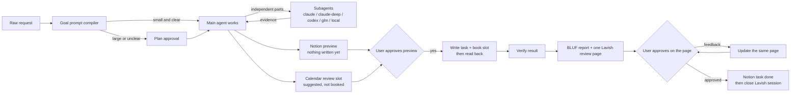

# Hermes Goal Setup: finish what you start

**BLUF:** This repo is my agent setup for one goal: tasks get **finished**, not only started. It has six portable parts. A prompt compiler turns a raw request into a verifiable task. Routing rules send parts to subagents. Notion tracks the task. A calendar slot holds the review. A Lavish review page shows the evidence and collects feedback. All replies use BLUF and simplified ASD-STE100.

## The problem

I start 10 agent tasks. None get finished.

The agents are not the problem. The missing structure is the problem. A raw prompt has no clear end, no limits and no proof. Results come back as walls of text. Nobody books time to review them. So the work stays half-done.

## What the setup does

1. **Compile the prompt.** The compiler sets the goal, the current state, the limits and the evidence. Small, clear tasks run directly. Large or unclear tasks need plan approval first.
2. **Route the work.** The main agent does the task itself, or gives independent parts to matching subagents. It stays responsible for verification and close-out.
3. **Track it in Notion.** For work of 30 minutes or more, or work with a review page, the main agent estimates a finish time and finds an existing Notion project.
4. **Hold a review slot.** The main agent suggests a free calendar slot for the review. Nothing is written or booked before you approve the full preview.
5. **Verify and show the result.** The main agent verifies the result itself and adds the evidence to the same task. For large results, it gives the conclusion first in the chat (BLUF + STE100) and links exactly one Lavish page. That page shows the result, the change, the evidence and the decision. Feedback updates the same page.
6. **Close after approval.** After approval, the main agent marks the same Notion task as done. Then it closes the Lavish session. Follow-up work starts separately.



**Who holds which state?** The Goal prompt holds the goal and the verification plan. Notion holds the human task status. The calendar holds only reserved time. Lavish holds the visible review state and the feedback about it. The worker supplies evidence. The main agent verifies it. Durable knowledge can go separately into an approved knowledge system. The output style does not change any approval.

## Components

| Part | Files | Task |
| --- | --- | --- |
| Prompt compiler | [Skill](skills/goal-prompt-compiler/SKILL.md) · [Template](skills/goal-prompt-compiler/GOAL-PROMPT.md) | Turns raw input into a verifiable work order. |
| Output style | [Style rules](output-style/OUTPUT-STYLE.md) | Shapes replies to the user: BLUF and simplified ASD-STE100. |
| Notion tracking | [Flow and page template](notion/TRACKING.md) | Keeps task, project, status and result together. |
| Calendar review slots | [Flow](calendar/REVIEW-SLOTS.md) · [Settings](calendar/review-policy.json) · [Slot logic](calendar/review_slots.py) | Finds a free time block for the review. |
| Subagent routing | [Routing rules](routing/SUBAGENTS.md) · [YAML template](routing/delegation.example.yaml) | Selects a matching execution route. |
| Lavish review | [Review and feedback](lavish/REVIEW.md) · [HTML template](lavish/review-page/template.html) | Shows evidence, collects feedback and records the approval. |
| Example | [Dry run](examples/EXAMPLE.md) | Shows one full run with invented data. |

## 5-minute quickstart

You need Python 3.9+ with time zone data. Clone the repo, then:

1. **Copy the skill.** Copy `skills/goal-prompt-compiler/` into the skill directory of a **test** profile. Do not blindly replace existing skills.
2. **Add the style block.** Add [OUTPUT-STYLE.md](output-style/OUTPUT-STYLE.md) to the active instructions of the main agent. Do not add it to each worker.
3. **Run the slot test.** From the repo root, run:

   ```sh
   python3 -B calendar/test_review_slots.py
   ```

   All 7 tests must pass. The test is offline. It does not touch a calendar.
4. **Do the dry run.** Go through the [example](examples/EXAMPLE.md) without write access.
5. **Open the review page.** Open [template.html](lavish/review-page/template.html) in a browser. It also works offline. Without Lavish, **Send** shows only text to copy.

Optional, after that:

- **Notion and calendar.** Set up Notion and calendar access separately in your target system. Resolve the schema, the project and the target calendar there. Do not write credentials or real references into this folder.
- **Lavish.** For the feedback channel, install Lavish and `lavish-loop` separately. Then check the flow in [lavish/REVIEW.md](lavish/REVIEW.md).
- **Routing.** Compare [delegation.example.yaml](routing/delegation.example.yaml) with your installation. Do not activate unknown routes. In a fresh session, test each approved route with a harmless task.

## Before / after: the example

Raw input: *"Turn my duplicated example table into a verified list and plan 20 minutes for the review."*

| | Before: raw prompt | After: compiled task |
| --- | --- | --- |
| Goal | "a verified list" | A local CSV from six synthetic rows. |
| Done when | not defined | Five unique rows remain. The test reports exactly one duplicate. |
| Limits | not defined | The source stays unchanged. No sending. No live writes. |
| Routing | not defined | Work directly. `codex` only if a parser becomes necessary. |
| Notion | not defined | Preview: "Five unique example rows verified" in "Test project". Nothing written. |
| Review | "plan 20 minutes" | Finished 10:08 → earliest 10:23 → slot `10:30–10:50`, buffer to 11:00. Not booked yet. |
| Report | — | "Done: The CSV contains five unique rows. The test found one duplicate. The source file did not change." |
| Review page | — | One [Lavish page](lavish/review-page/template.html) with result, evidence and one decision. |

Full walkthrough: [examples/EXAMPLE.md](examples/EXAMPLE.md).

## Limits: what this is not

- **No installer.** These are templates. Nothing starts, connects or writes when you open them.
- **No backup of a live profile.** This is a sanitized export of the workflows and selected settings.
- **No write adapters.** The repo does not write to Notion or to a calendar. You set up that access in your own system.
- **No credentials.** The repo has no credentials, real Notion references, company content, internal endpoints, sessions or live data. The provider, model and endpoint placeholders do not resolve. This is intentional.
- **The local test checks only the slot logic.** It does not check a connection to a calendar service.
- **Lavish is not included.** Lavish and `lavish-loop` are installed separately. The repo does not install them. The template opens offline, but the feedback channel works only in a real Lavish session.

## Origin

The setup comes from the goal prompt compiler, the style template and the active reply rules, the task run, the Notion intake rules, the subagent delegation and the Lavish rules with review page v2 of my running Hermes setup. Workflows and selected settings are copied. Examples, account references, design and installation-specific parts are neutralized.

## Credits

- Review pages and feedback loop use Lavish by Kun Chen ([kunchenguid/lavish-axi](https://github.com/kunchenguid/lavish-axi)).
- The writing rules are an informal adaptation of selected rules from [ASD-STE100 Simplified Technical English](https://www.asd-ste100.org/). They are not formal conformance to the standard.

## Author

Built by Leon Phull ([@LeonPhull](https://x.com/LeonPhull) on X).

## License

[MIT](LICENSE)
